[](https://github.com/alexmaietta/apollo-astronaut-asset/releases/latest)
[](LICENSE)
[](assets/LICENSE)
[](https://docs.omniverse.nvidia.com/composer/latest/prod_content/mount-content.html#astronaut)


[](https://github.com/newton-physics/newton)

# Apollo 11 Astronaut (A7L EVA suit)

A rigged, simulation-ready Apollo astronaut built on **[NVIDIA's Omniverse Astronaut sample](https://docs.omniverse.nvidia.com/composer/latest/prod_content/mount-content.html#astronaut)**: a static, high-detail model of Buzz Aldrin's A7L suit, with NVIDIA's original 4K MDL materials and textures. This repo turns it into a skinned **UsdSkel** character with OpenXR joints, physics hands with A7L glove stiffness and GPU full-body IK, and drives it in interactive examples for the [Newton](https://github.com/newton-physics/newton) physics engine.

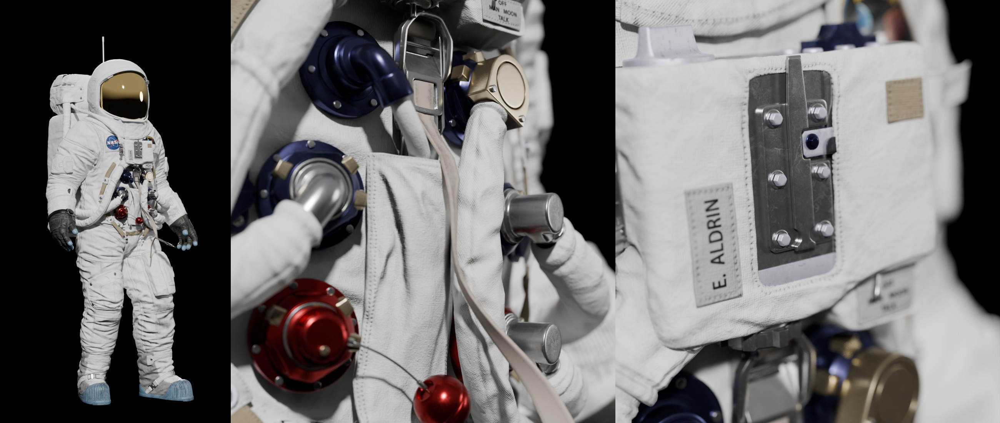

What it adds to NVIDIA's model:

- **Rig.** 84-joint UsdSkel skeleton with [OpenXR](https://registry.khronos.org/OpenXR/specs/1.1/html/xrspec.html#XR_EXT_hand_tracking) names and joint frames (XR_FB / XR_META full-body tracking, 26 joints per hand as in XR_EXT_hand_tracking), skinned to all 34 suit meshes (389k vertices).
- **Gloves and hands.** Finger joints fitted to the glove geometry, 20-DoF physics hands per side with the pressurised glove's stiffness, OpenXR / Manus teleoperation input and per-finger haptics (see [Hands and grasping](#hands-and-grasping)).
- **Suit behaviour.** Shoulder corrective blend shapes driven by an RBF, A7L range-of-motion limits, collision-aware arm IK, and pose-driven suit body colliders.
- **Formats.** A SimReady/Isaac-style **USD** asset with `Physics` and `BodyColliders` variants, plus a rigged **Blender** file (armature, corrective shape keys, textures packed).

## Quick start

Download the format you need (`astronaut-usd` or `astronaut-blend`) from the [latest release](https://github.com/alexmaietta/apollo-astronaut-asset/releases/latest). To pin a version, use `download/v1.0.0` instead of `latest/download`. Each release includes `SHA256SUMS`.

```sh
curl -LO https://github.com/alexmaietta/apollo-astronaut-asset/releases/latest/download/astronaut-usd.zip
unzip astronaut-usd.zip   # -> astronaut/astronaut.usda
```

Or clone the repo for the source, the examples and the same assets in `assets/`. They're stored with Git LFS (set `GIT_LFS_SKIP_SMUDGE=1` to skip them). Then start with the **interactive full-body IK demo**, using [uv](https://docs.astral.sh/uv/):

```sh
git clone git@github.com:alexmaietta/apollo-astronaut-asset.git && cd apollo-astronaut-asset && git lfs pull
uv venv && source .venv/bin/activate
uv pip install "newton[examples]"
python examples/newton/example_astronaut_ik.py   # drag the gizmos on the hands, feet and hips
```

### Examples

All examples run on stock `newton[examples]` (tested with Newton 1.6.1 from PyPI) and load the committed asset from `assets/`. Each one has a headless `--test` check (`./pipeline.sh test` runs them all).

| | |
|---|---|
| 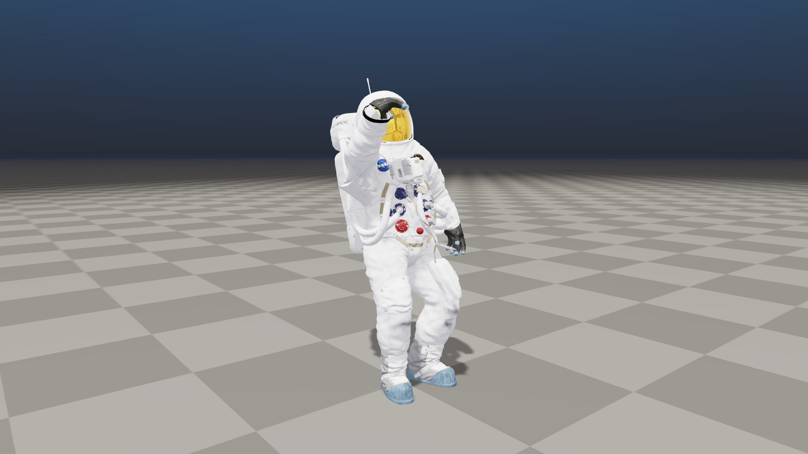 | **[`example_astronaut_ik.py`](examples/newton/example_astronaut_ik.py): interactive full-body IK (start here).** Drag the transform gizmos on the hands, feet and hips. On every frame the GPU full-body IK (Newton's batched Levenberg–Marquardt, captured as one CUDA graph, about 1.2 ms) re-solves 46 DoF. It reaches the targets while keeping the posture close to the start pose, inside the joint limits and the A7L shoulder range, and out of the suit body (capsule self-collision with analytic Jacobians). The panel shows the start pose, collision and suit-ROM toggles, iterations, live target errors, shoulder margins and arm clearance. `--pose <name>` picks the start pose. |
| 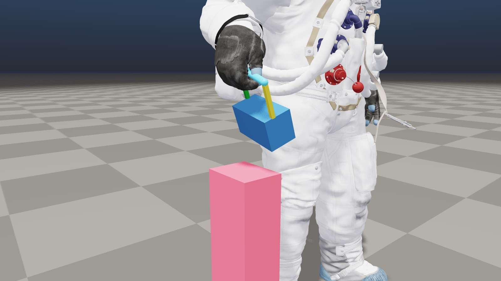 | **[`example_astronaut_grasp.py`](examples/newton/example_astronaut_grasp.py): manipulation.** The physics hands (`Physics=mujoco`) pick up a sample carrier by its handle under lunar gravity. All control runs on the GPU in one CUDA graph per frame: a device-side task clock, the grip, the wrist mount, collision, solver substeps, contact forces and haptics. The GUI has the scripted task, a manual grip slider, live suit pressure and a collider view. `--pressure 0` gives an unpressurised glove for comparison. `--thumb 0 --lift 0.08 --body-colliders none --hand-offset 0.15 -0.15 0.02` is the hook grip used for the renders below, with the hand starting out to the side and forward. |
| 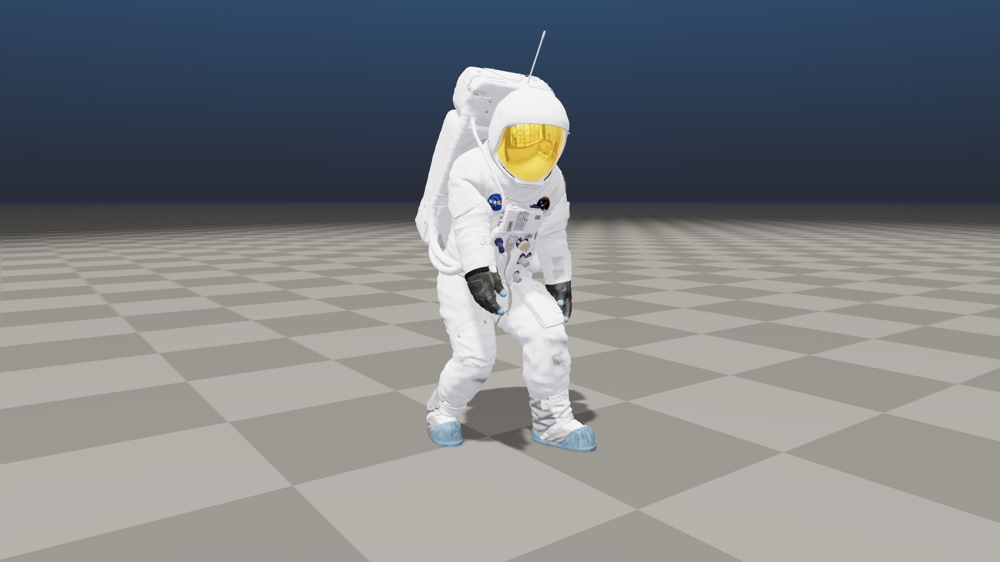 | **[`example_astronaut_poses.py`](examples/newton/example_astronaut_poses.py): pose editor.** Start from the pose library (bind, stand, lope, salute, geology, walk, tpose, your saved poses). Then adjust the root offset, the hip, spine and chest bend, side and twist, the hand and foot IK targets, and the finger grip per hand, with optional GPU full-body IK refinement. Save poses by name to `data/user_poses.json` (`--pose <name>` starts from one) or export `build/hero_<name>.usd` for the Cycles renderer. |
| 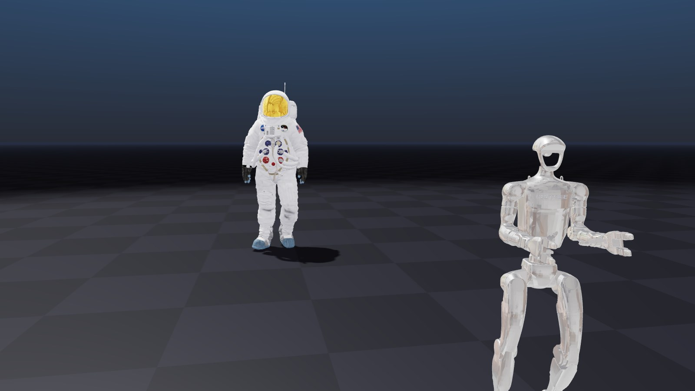 | **[`example_astronaut_walk.py`](examples/newton/example_astronaut_walk.py): locomotion retarget.** Newton's Unitree G1 walking policy (ONNX, MuJoCo-Warp) is retargeted onto the astronaut walking beside the robot, and every frame is cleaned up by the GPU full-body IK (`--no-fullbody-ik` to compare). Keys i/j/k/l/u/o to steer, p to reset. `--record build/walk_anim.usda` saves a UsdSkel animation with the shoulder-corrective weights. The G1 policy and model download from newton-assets on first run. |

The Warp kernels behind the examples live in [`examples/newton/kernels/`](examples/newton/kernels/): full-body IK, hand control and OpenXR retargeting, haptics, and GPU skinning with correctives. The tools for the README images live in [`examples/newton/utils/`](examples/newton/utils/): grasp recording and viewer screenshots.

To explore the asset in Isaac Sim or another Omniverse app, open `assets/astronaut/astronaut.usda` and switch the `Physics` and `BodyColliders` variants. NVIDIA's original MDL looks render there as authored.

## Hands and grasping

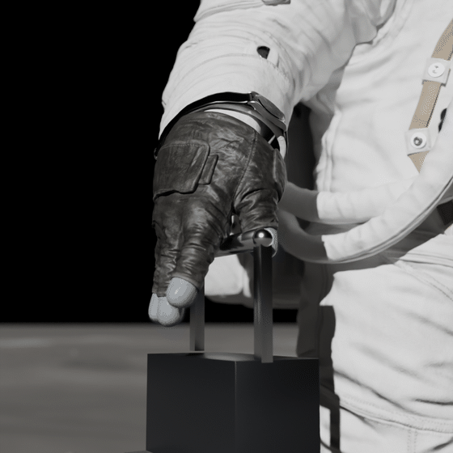

The GIF and the close-ups are the simulation itself. [`record_grasp.py`](examples/newton/utils/record_grasp.py) runs the grasp example headless and saves the GPU-skinned glove for each frame, with fingers posed from the simulated finger bodies. Cycles then renders those vertices unchanged. The hand starts out to the side and forward of the body. The pressurised glove closes into a hook grip on the handle, lifts the 1.2 kg carrier under lunar gravity and holds it, with every finger in contact (mean grip while holding: thumb 24, index 45, middle 15, ring 24 and pinky about 100 N).

| 0.5 s: hand open | 1.0 s: fingers closing | 1.5 s: hook grip on the handle | 2.5 s: lifting | 4.0 s: holding |
|:-:|:-:|:-:|:-:|:-:|
| 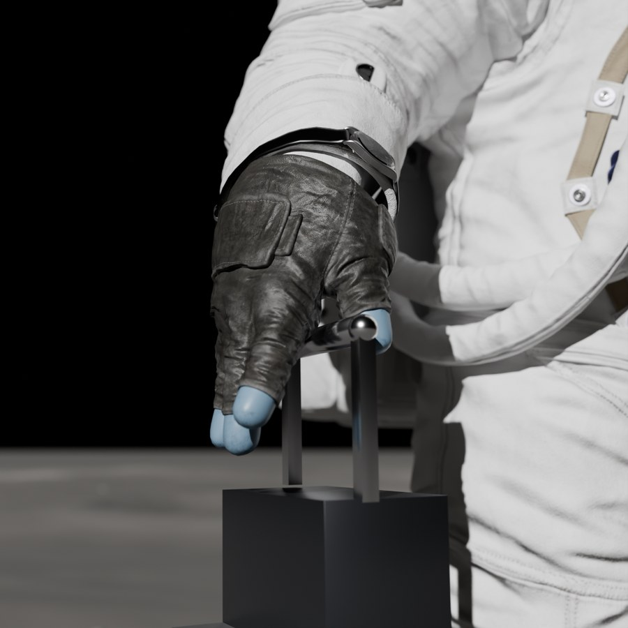 | 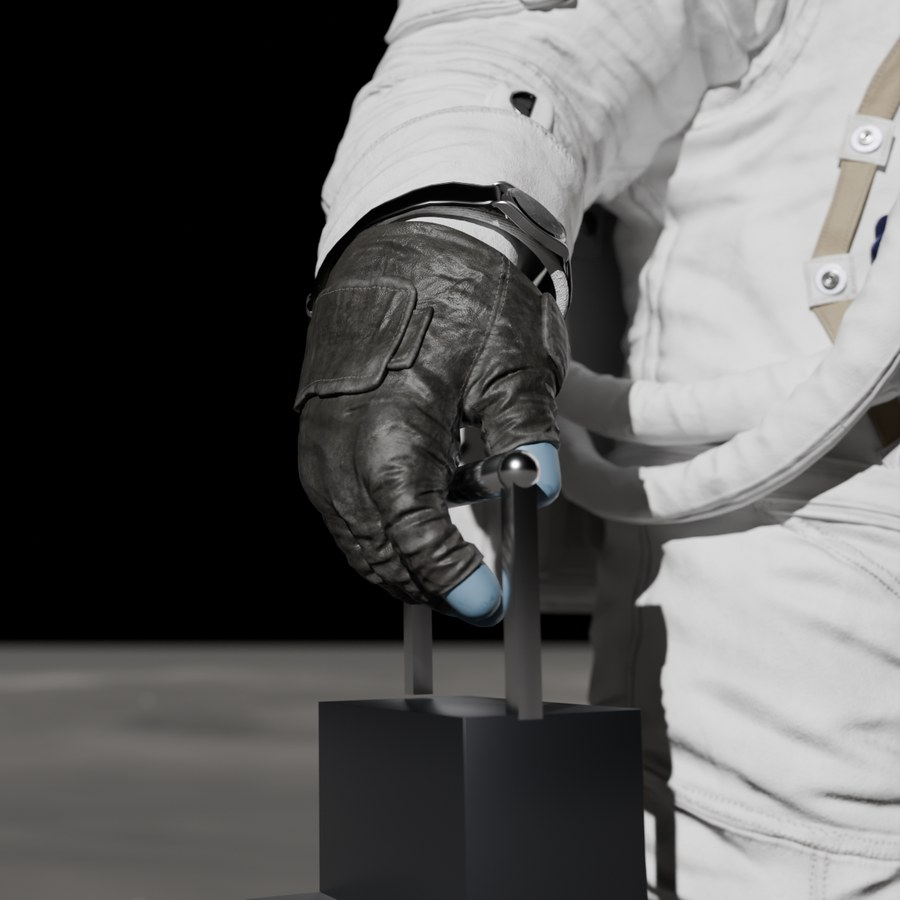 | 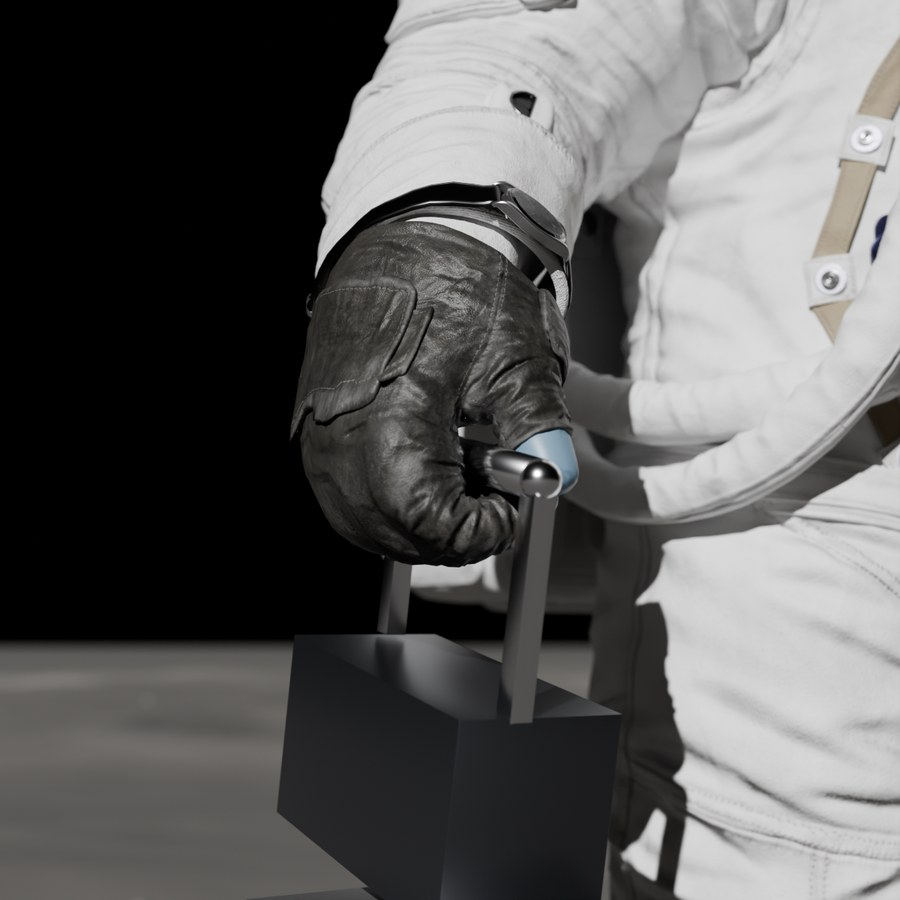 | 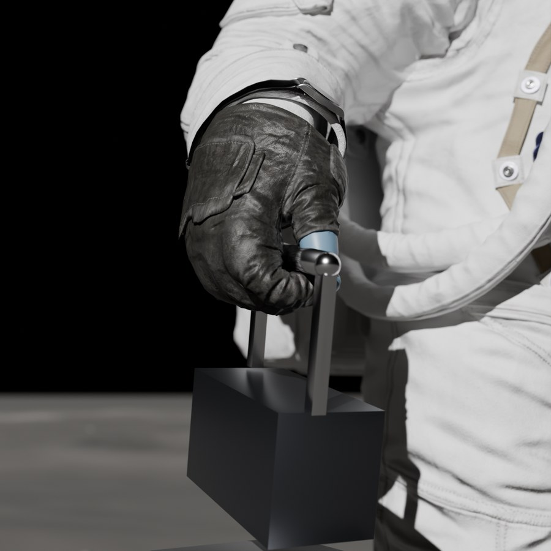 | 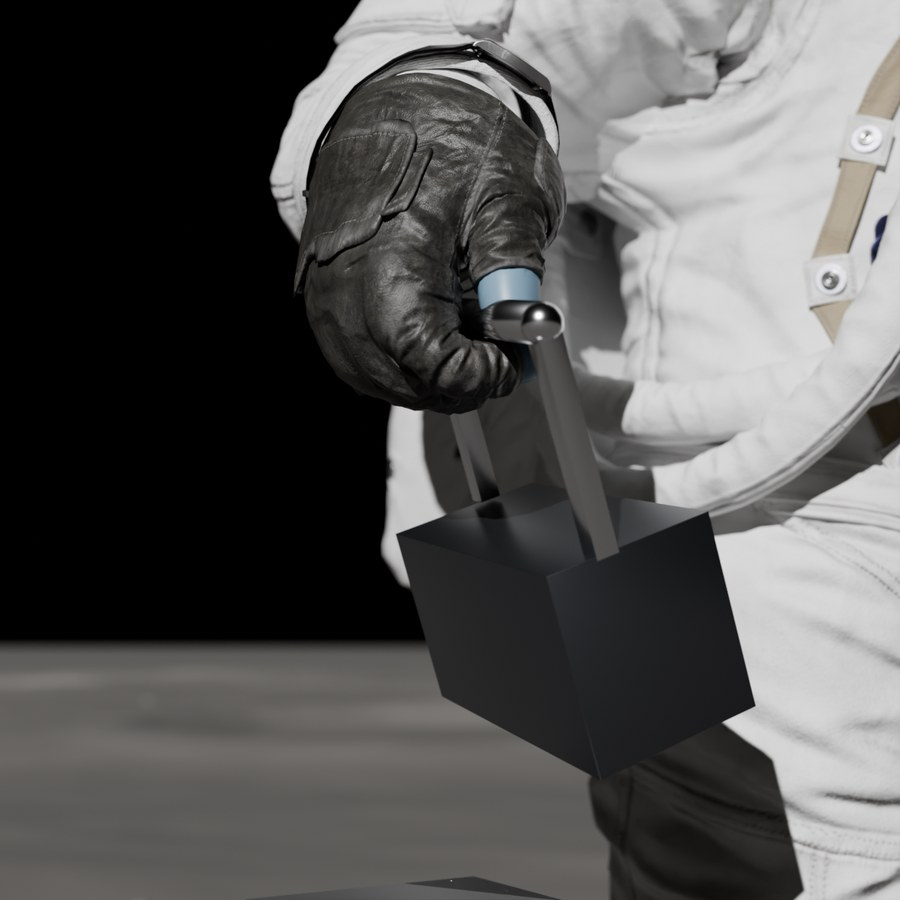 |

- **Fingers fitted to the glove.** A least-squares circle fit through each finger's cross-sections centres the knuckles inside the glove's finger tubes. The fingertip joints end at the blue silicone fingertip caps of the Apollo EV glove (NVIDIA's texture), and the open glove tips are capped.
- **20-DoF physics hand per side, 21 bodies.** Capsule fingers sized from the circle fits and a palm box, as in Newton's Allegro hand. Revolute joints sit on the OpenXR axes at the bind angles, with limits from the glove's reduced range of motion. A fixed "wrist mount" joint per hand is what teleop moves to the tracked wrist pose.
- **A7L glove stiffness.** The pressurised glove is modelled as passive joint springs (`mjc:stiffness`, `mjc:springref`, damping, armature) that scale linearly with suit pressure (3.7 psi reference, adjustable live in the GUI). Finger servos are clipped to human finger torque (0.7–3 N·m per joint). In free air, a 50° command settles at kp / (kp + k_suit) × 50° against the glove spring (MCP 46.5°, PIP 48.2°, DIP 49.0°), which matches the model.
- **Teleop input.** The [OpenXR adapter](examples/newton/kernels/openxr_adapter.py) maps 26 OpenXR or Manus joint poses per hand (or per-joint angles) to physics joint targets. Its Warp version in [`hand_control.py`](examples/newton/kernels/hand_control.py) matches the CPU reference to 7e-7 rad. Targets are exactly zero at the bind pose, a known joint rotation is recovered exactly, and whole-hand rotation leaves the finger targets unchanged. A live stream plugs into `HandControlGPU.write_openxr_targets`.
- **Haptics.** [`haptics.py`](examples/newton/kernels/haptics.py) gives the normal grip force per finger from a Newton `SensorContact`, in Isaac Lab's glove format (thumb, index, middle, ring, pinky). `send()` forwards it to any `HapticFeedbackReceiver` (Isaac Teleop → Manus glove).
- **Suit body colliders.** The `BodyColliders` variant has 14 kinematic suit proxies: the torso as two capsules, the helmet, the PLSS, and the upper arms, forearms, thighs, shins and feet. They follow the skeleton like the wrist mounts, and the fingers and held objects collide with them. A hand pushed into the body stops about 3 mm from it instead of passing 25 mm in.

## Walking

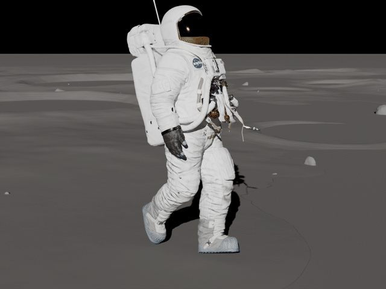

A motion-captured human walk from the [CMU Graphics Lab Motion Capture Database](http://mocap.cs.cmu.edu) (subject 35, trial 1), two full gait cycles from heel strike to heel strike so the loop is seamless. [`record_walk.py`](examples/newton/utils/record_walk.py) retargets it onto the OpenXR skeleton: the pelvis and chest orientations come from frames through the hips and shoulders, the spine is blended between them, and each limb bone follows the captured bone direction. The root is scaled by the leg-length ratio. The GPU full-body IK then cleans up every frame, keeping the feet and hands where the retarget puts them, the arms out of the suit body and the shoulders inside the A7L range. The GPU skinning writes the vertices that Cycles renders, and the walk is also saved as a UsdSkel animation on the asset (`build/walk/walk_anim.usda`, correctives included) for Omniverse or usdview. The mocap files download to `build/mocap/` and aren't redistributed; [`cmu_mocap.py`](examples/newton/utils/cmu_mocap.py) reads any CMU ASF/AMC trial.

## Gallery

Cycles renders (OptiX, 384 spp, all 1600 × 1200) from [`scripts/render_hero.py`](scripts/render_hero.py), using the poses in [`scripts/poses.py`](scripts/poses.py). The suit uses NVIDIA's original textures through the rig's UsdPreviewSurface networks, with lunar dust graded by height added on top. The visor is Cycles gold. The ground, craters, rocks, flag and Earth are procedural.

| | |
|:-:|:-:|
| 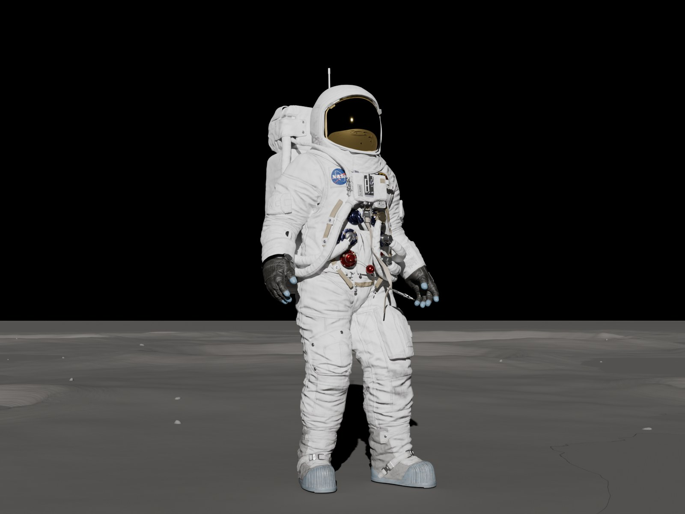 | 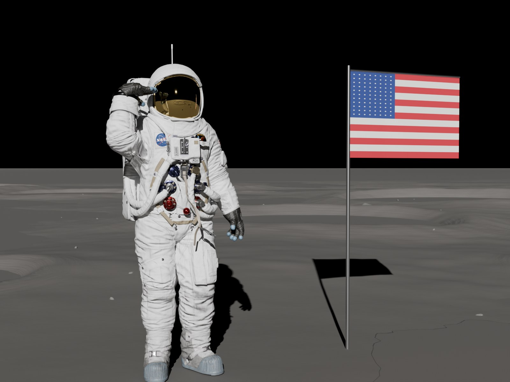 |
| 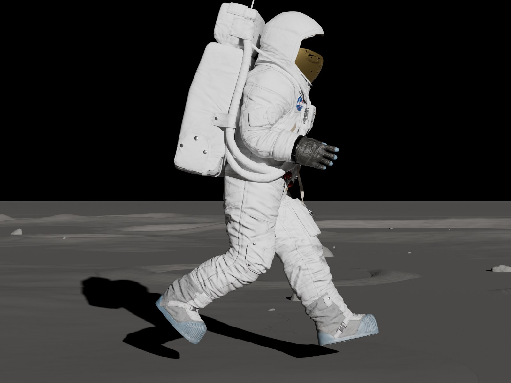 | 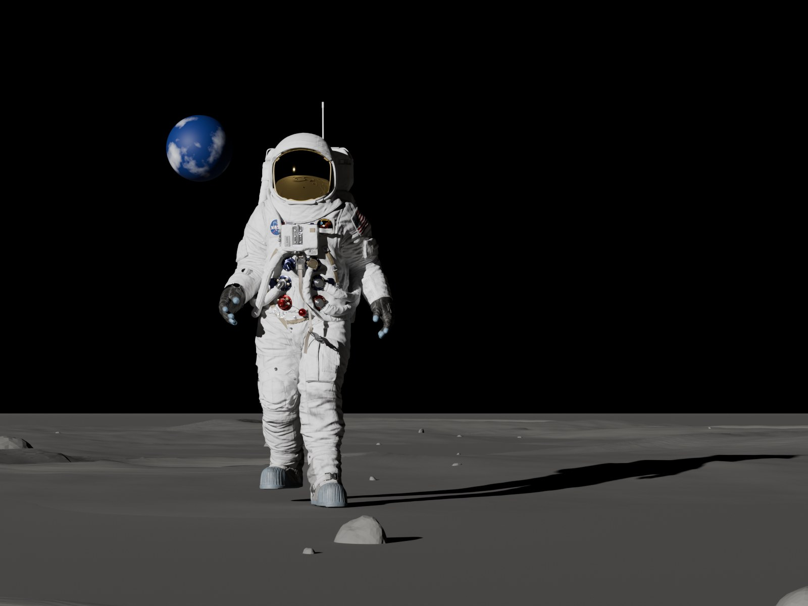 |
| 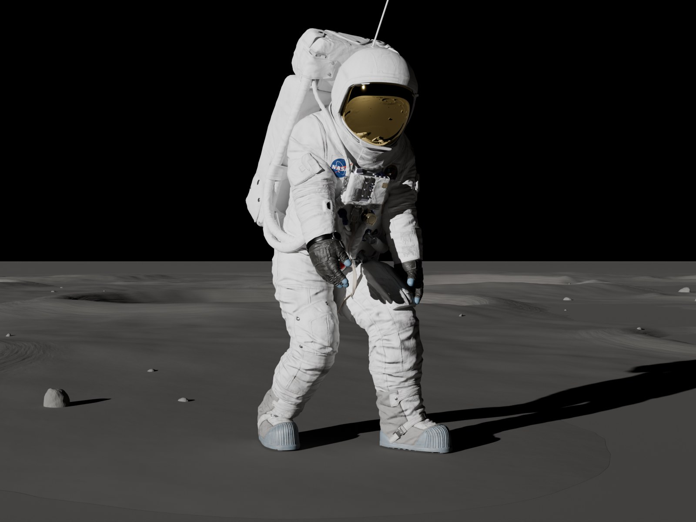 | 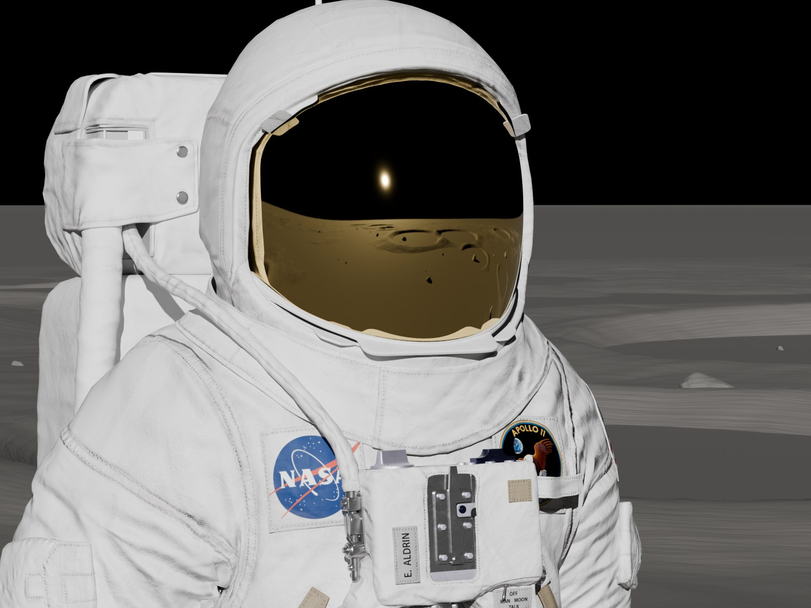 |
| 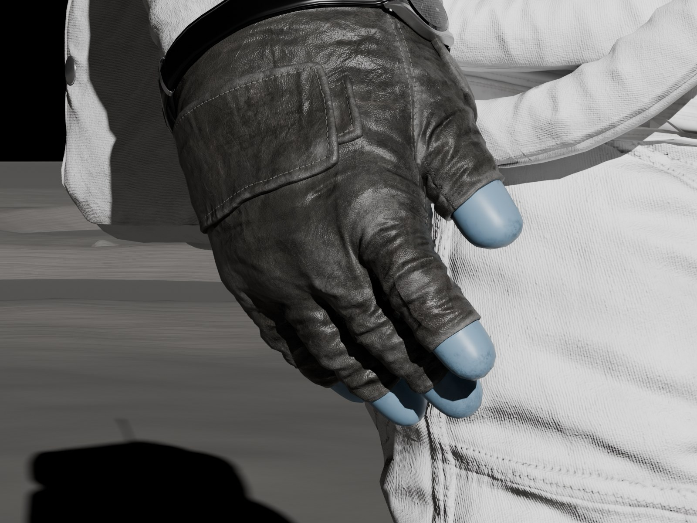 | 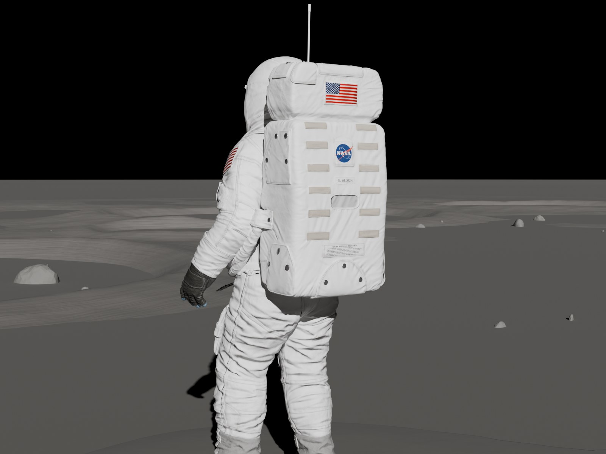 |

## The rig

- **Units and frame.** Metres, Z-up, facing +X (left = +Y), with the origin on the ground under the Root joint. (NVIDIA's source is centimetres, though its file says `metersPerUnit = 0.1`. The build treats it as cm.)
- **Joint frames.** These follow XR_EXT_hand_tracking: +Z runs along the bone, pointing away from the child; +Y points out of the back of the hand or nail; X = Y × Z. The body follows the same rule: +Y is the back of the hand along the arm, forward for the spine and legs, and up for the clavicles and foot bones. XR_FB_body_tracking doesn't define per-joint axes, so some body-tracking runtimes may need an adapter.
- **Skinning.** The soft suit layers get visibility-tested inverse-distance weights, with the arm bones gated by surface distance from the wrist and the weights smoothed along mesh edges. Rigid parts:
  - the boots, below the ankle
  - the helmet, PLSS and RCU on the chest (the A7L helmet is fixed to the neck ring)
  - the wrist rings, wristwatch and forearm gauge on the forearm
  
  Pockets and patches follow the nearest suit vertex. The rig's own numpy skinning matches UsdSkel's skinning of the authored transforms to 3e-7 m.
- **Shoulder correctives.** Five UsdSkel blend shapes per shoulder: side raise at 90° and 150°, forward raise at 90° and 150°, and back 45°. They're solved with as-rigid-as-possible deformation and driven by an RBF on the upper-arm direction in the chest frame. The driver data is in the skeleton's `customData["astronaut:correctives"]`. UsdSkel has no drivers, so anything that animates the skeleton must also author the weights, or the shoulders lose up to 75 mm of correction in a walk and over 200 mm with the arms raised. [`skel_animation.py`](scripts/skel_animation.py) does this: `write_animation(rig, frames, path, fps)` writes joint transforms plus per-frame `blendShapeWeights` (both walk tools use it), and USD's own skinning of the result matches the Newton skinning exactly. For a live stream such as OpenXR body tracking, compute `rig.corrective_weights(W)` from each frame's joint world matrices and write them to the animation's `blendShapeWeights` in `corrective_names(rig)` order.
- **Materials.** Each look carries NVIDIA's original MDL shader (`outputs:mdl:surface`) and a UsdPreviewSurface network on the same textures (`outputs:surface`). Renderers without MDL (Blender, Newton, generic Hydra) still get every texture map.

## USD asset

The layout follows the Isaac Sim robot-asset structure and the SimReady Robot-Body profile, the same as the [Apollo LRV asset](https://github.com/alexmaietta/apollo-lrv-asset):

```
astronaut/
  astronaut.usda                  interface: SkelRoot, Physics + BodyColliders variant sets, SimReady_Metadata
  payloads/
    base.usda                     references geometries.usd and materials.usda
    geometries.usd                skinned rig: Skeleton, 34 meshes, corrective blend shapes (crate)
    materials.usda                NVIDIA's MDL + UsdPreviewSurface looks
    Textures/                     NVIDIA's 4K texture sets
    Physics/physics.usda          hands: rigid bodies, capsule/box colliders, revolute joints, drives, wrist mounts
    Physics/mujoco.usda           + A7L glove passive springs, damping, armature, MjcActuator servos
    BodyColliders/capsules.usda   14 pose-driven suit proxies
  .thumbs/256x256/astronaut.usda.png
```

| Variant set | Options (**default**) |
|---|---|
| `Physics` | none, physics (UsdPhysics + Newton schemas, PhysicsDriveAPI servos), **mujoco** (adds the glove springs and MuJoCo actuators) |
| `BodyColliders` | none, **capsules** |

You can tune the glove and suit in [`data/suit_params.json`](data/suit_params.json): suit pressure, per-joint glove stiffness and damping, range-of-motion limits, human finger torque, teleop servo gains, hand mass, friction and contact settings. Re-run `./pipeline.sh package assets` after editing.

The Blender file (`assets/blender/astronaut.blend`) is imported from the USD asset. It has an 84-bone armature, all meshes skinned, the 20 corrective shape keys (weight 0; the RBF driver isn't recreated as Blender drivers) and the textures packed.

## Validation

| Validator | Result |
|---|---|
| `simready-validate` 2026.8, profile Robot-Body 3.0.0 | **PASSED** (only optional features are unmet, such as OpenPBR and ROS) |
| `nvidia_usd_validate` (usd-validation-nvidia 1.22, all 6 variant combinations) | 0 errors outside the MDL looks. NVIDIA's MDL shaders report as not in the Sdr registry, and `OmniPBR.mdl`/`OmniGlass.mdl` as unresolved, because usd-core has no MDL plugin or Omniverse MDL search path. Both resolve in Omniverse apps. Remaining warnings are mesh quality only (co-located points). |
| Newton 1.6.1 (PyPI) and 1.7-dev | All four examples pass `--test`. In the grasp, the carrier lifts 17.7 cm (default grip) or 9.7 cm (hook grip, 8 cm lift) |

```bash
.venv/bin/nvidia_usd_validate --group-by rule_name assets/astronaut/astronaut.usda
# SimReady specs: sparse checkout of the spec tier (~19 MB) from github.com/NVIDIA/simready-foundation
GIT_LFS_SKIP_SMUDGE=1 git clone --depth 1 --filter=blob:none --sparse https://github.com/NVIDIA/simready-foundation.git
git -C simready-foundation sparse-checkout set nv_core/tiers/simready_foundation_tier_core
T=simready-foundation/nv_core/tiers/simready_foundation_tier_core/simready/foundation/tier_core
.venv/bin/simready-validate --rules-path $T/capabilities --features-path $T/features --profiles-path $T/profiles \
    --profile Robot-Body --version 3.0.0 assets/astronaut/astronaut.usda
```

## Rebuild

You need Blender 5.2 on `PATH` (or set `BLENDER=/path/to/blender`) and a uv venv (Python 3.13) with `bpy`, `usd-core`, `scipy`, `pillow` and `newton[examples]`. `PY` and `NEWTON_PY` override the interpreters, and both default to `.venv/bin/python`.

```bash
./pipeline.sh              # textures -> rig + correctives -> USD package -> Blender file -> assets/ -> example tests
./pipeline.sh update       # rebuild the rig, USD and Blender file and copy them into assets/ (committed with Git LFS)
./pipeline.sh test         # headless --test of every Newton example
./pipeline.sh images       # Cycles poses + grasp close-ups/GIF, Newton screenshots -> docs/images, asset thumbnail
./pipeline.sh release      # stamp VERSION, rebuild, refresh assets/ and build the release zips
```

The source textures (`source/textures/`, Git LFS) mirror NVIDIA's public Omniverse S3 bucket. Each file's upstream URL is in [`data/texture_sources.json`](data/texture_sources.json), and `scripts/fetch_textures.py` restores missing files from S3 (`--verify` checks them).

Scripts (asset build: numpy, OpenUSD, Blender):

- [`skeleton.py`](scripts/skeleton.py), [`joint_frames.py`](scripts/joint_frames.py), [`fit_hands.py`](scripts/fit_hands.py): joint positions, OpenXR frames, glove finger fit
- [`build_rig.py`](scripts/build_rig.py), [`correctives.py`](scripts/correctives.py): the skinned rig and the shoulder blend shapes
- [`rig.py`](scripts/rig.py): numpy FK, RBF corrective weights, linear blend skinning
- [`skel_animation.py`](scripts/skel_animation.py): UsdSkel animation export with the corrective weights
- [`poses.py`](scripts/poses.py): the pose library with collision-aware two-bone IK, and the baker for the renders
- [`hand_physics.py`](scripts/hand_physics.py): the 20-DoF hand model
- [`package_simready.py`](scripts/package_simready.py): the SimReady USD asset
- [`export_blend.py`](scripts/export_blend.py): the Blender file
- [`render_hero.py`](scripts/render_hero.py), [`gallery.py`](scripts/gallery.py): Cycles renders, the grasp and walk GIFs and README images
- [`make_release.py`](scripts/make_release.py): the release zips

### Versions and releases

The asset version lives in `VERSION`. The packager stamps it into the USD as `assetInfo.version` on `/astronaut`, and as `asset_version` in the root layer's `customLayerData` and `SimReady_Metadata` (which also record the authoring OpenUSD version).

To cut a release:

1. Bump `VERSION` and run `./pipeline.sh release`. It rebuilds every format, refreshes `assets/` with the new version and builds the release zips in `build/release/v<VERSION>/` so you can check them.
2. Commit `assets/` and `VERSION`, tag the commit `v<VERSION>`, and push the tag.
3. The [release workflow](.github/workflows/release.yml) checks that the tag matches `VERSION` and the stamped USD, zips the committed assets and publishes the GitHub release with `SHA256SUMS`.

## Known limitations

- **Grasp.** With the default grip and the suit colliders on, the carrier hangs tilted: only the index and middle fingers carry it, and it swings into the thigh proxy. The hook grip used for the renders holds it within about 25° and sets it back down, but the set-down still lands it slightly tilted. Grip forces under contact vary between runs (GPU contact ordering), so judge the glove-stiffness effect from free-air finger motion. Newton's own contact pipeline (`--no-mujoco-contacts`) is less robust for this grasp than MuJoCo's contacts, and self-collision between fingers is off.
- **Wrist during the lift.** The visual arm follows the wrist mount through a CPU two-bone IK, and the hand keeps the mount's orientation. A large lift from the bind pose therefore bends the wrist sharply (about 40° at 15 cm) and the cuff skinning folds. The renders start the hand out to the side and forward (`--hand-offset`) and lift 8 cm, which keeps the wrist nearly straight and the arm clear of the body.
- **Underarm webbing.** NVIDIA's sculpt has the sleeves fused to the torso sides, so raising an arm past about 120° still webs at the underarm, even with the correctives. The real A7L couldn't raise its arms much past shoulder height either. Fixing it needs the underarm re-sculpted.
- **Range-of-motion values.** The suit limits in `data/suit_params.json` (`body_rom`) are estimates to tune. In the bent-over geology pose the forearm still touches the suit by about 3 cm.
- **Walk retarget.** The G1 demo is a visual retarget (Earth gravity, G1 dynamics, short quick steps); the walk GIF uses human motion capture instead. Both walk at Earth pace, not the Apollo lunar lope. Next: an astronaut physics body with its own policy.

## License

Copyright 2026 Alex Maietta (see [`NOTICE`](NOTICE)).

- **Source asset.** The astronaut mesh, its MDL materials and its textures (`source/`, and the geometry and textures carried into `assets/`) are NVIDIA's [Omniverse Astronaut sample](https://docs.omniverse.nvidia.com/composer/latest/prod_content/mount-content.html#astronaut), © NVIDIA Corporation. They remain under NVIDIA's terms for Omniverse sample content (the [NVIDIA Omniverse License Agreement](https://docs.omniverse.nvidia.com/dev-overview/latest/common/NVIDIA_Omniverse_License_Agreement.html)) and are not relicensed here.
- **Code** (`scripts/`, `examples/`, `pipeline.sh`): [Apache License 2.0](LICENSE).
- **Additions to the asset** (the skeleton, skin weights, corrective blend shapes, physics hands, glove parameters and body colliders in `assets/`, plus `data/`) and the **renders** (`docs/images/`): [Creative Commons Attribution 4.0 International](assets/LICENSE). Credit: "Apollo astronaut rig by Alex Maietta, built on NVIDIA's Omniverse Astronaut sample".

The Newton examples are based on Newton's examples and are Apache-2.0, © The Newton Developers. The walk animation in `docs/images/walk.gif` uses motion data from the [CMU Graphics Lab Motion Capture Database](http://mocap.cs.cmu.edu), created with funding from NSF EIA-0196217; the raw data isn't included in this repository. This project is not affiliated with or endorsed by NVIDIA or NASA.
